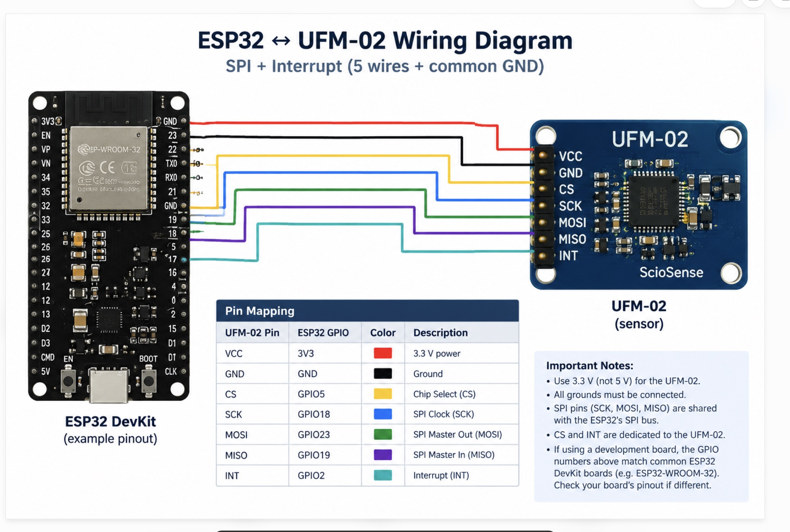

# ScioSense UFM-02 ESPHome Component

An ESPHome custom component for integrating the **ScioSense UFM-02 ultrasonic flow sensor** with an ESP32 over SPI.

## Features

The component is designed to expose five optional sensor entities:

- **Water Flow Rate** — instantaneous flow rate.
- **Water Filtered Flow Rate** — filtered flow rate.
- **Water Total Volume** — accumulated volume.
- **Water Temperature** — measured temperature.
- **Water Sensor Error Flags** — sensor status/error flags.

> **Implementation status:** The current code provides the component structure, GPIO initialization, SPI configuration, and optional sensor entities. The UFM-02 register-reading protocol and measurement decoding still need to be implemented and verified. The five entities will not report valid measurements until that work is complete.

## Hardware

- ScioSense UFM-02 ultrasonic flow sensor
- ESP32 DevKit V1 (ESP-WROOM-32)
- Suitable 10-pin cable or breakout wiring
- ESPHome 2026.9.x

## Wiring

The following example uses the ESP32's VSPI GPIO assignments.

| UFM-02 signal | ESP32 connection | Description |
|---|---|---|
| VCC | 3V3, if supported by your module | Sensor power |
| GND | GND | Common ground |
| CS | GPIO5 | SPI chip select |
| SCK | GPIO18 | SPI clock |
| MO / MOSI | GPIO23 | Controller-to-sensor data |
| MI / MISO | GPIO19 | Sensor-to-controller data |
| INT | GPIO2 | Interrupt signal |

**Electrical precautions**

- Verify the supply-voltage requirements for your exact UFM-02 module revision before connecting VCC.
- Ensure ESP32 GPIO pins are never exposed to voltages above 3.3 V.
- Connect the sensor and ESP32 grounds together.
- Verify the sensor connector's pin-1 orientation against its datasheet; do not rely on cable wire colours.
- GPIO2 is a boot-strapping pin on the classic ESP32. If it causes startup problems, use a suitable alternative GPIO and update the YAML.

## Installation

Create the following directory structure in your ESPHome configuration:

```text
/config/
├── water-meter.yaml
└── components/
    └── ufm02/
        ├── __init__.py
        ├── sensor.py
        ├── ufm02.h
        └── ufm02.cpp
```

Place the component source files in `/config/components/ufm02/`.

The `__init__.py` file can remain empty if the configuration schema and code generation are implemented in `sensor.py`.

The component must use ESPHome's SPI-device interface and register its device with the ESPHome SPI component. Confirm that the Python schema, C++ class and code-generation methods match the installed ESPHome version.

## ESPHome configuration

Add the following to `water-meter.yaml`:

```yaml
spi:
  clk_pin: GPIO18
  mosi_pin: GPIO23
  miso_pin: GPIO19

sensor:
  - platform: ufm02
    id: ufm02_device
    cs_pin: GPIO5
    int_pin: GPIO2
    update_interval: 1s

    flow:
      name: "Water Flow Rate"
      icon: mdi:water-pump

    filtered_flow:
      name: "Water Filtered Flow Rate"
      icon: mdi:water

    total_volume:
      name: "Water Total Volume"
      icon: mdi:counter

    temperature:
      name: "Water Temperature"
      icon: mdi:thermometer

    error_flags:
      name: "Water Sensor Error Flags"
      icon: mdi:alert-circle
```

Only configure GPIO assignments that match your actual wiring.

## SPI configuration

The intended SPI configuration is:

| Setting | Value |
|---|---|
| SPI mode | Mode 1 |
| Clock polarity (CPOL) | 0 |
| Clock phase (CPHA) | 1 |
| Bit order | MSB first |
| Example clock rate | 1 MHz |

Confirm the supported clock rate and transaction details against the official UFM-02 documentation and library.

## Building and troubleshooting

Validate the configuration:

```bash
esphome config /config/water-meter.yaml
```

Compile the firmware:

```bash
esphome compile /config/water-meter.yaml
```

Upload the firmware using your usual ESPHome installation and inspect the logs.

### Common issues

**`name` or `register_address` is an invalid option**

The installed component schema may still be configured for an earlier raw-register sensor. Check `components/ufm02/sensor.py` and ensure it defines the five optional sensor keys shown above.

**`LOG_SENSOR` macro argument error**

ESPHome 2026.9 expects three arguments:

```cpp
LOG_SENSOR("  Flow: ", "Flow", flow_sensor_);
```

Apply the same three-argument format to each sensor entity.

**SPI device registration or compilation errors**

Check the installed ESPHome version's SPI-device API. Ensure the class inheritance, SPI registration, GPIO types and Python code-generation setters match exactly.

**No measurement values**

GPIO initialization and successful compilation do not prove that the sensor is communicating. Implement and verify the UFM-02 register transactions, measurement decoding, scaling, error handling and publication logic before relying on the reported values.

## Official resources

- ScioSense UFM-02 Arduino library: https://github.com/sciosense/ufm02-arduino
- ESPHome documentation: https://esphome.io/
- ESPHome external components: https://esphome.io/components/external_components/
- ESPHome SPI component: https://esphome.io/components/spi/

## License

Specify the license for this component before redistributing it. Review the license of the ScioSense library separately if you vendor or adapt its source code.

## Wiring Diagram
